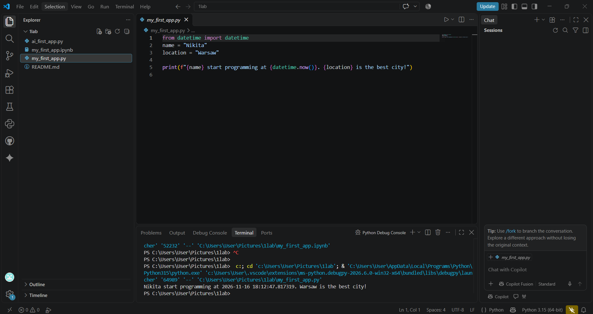
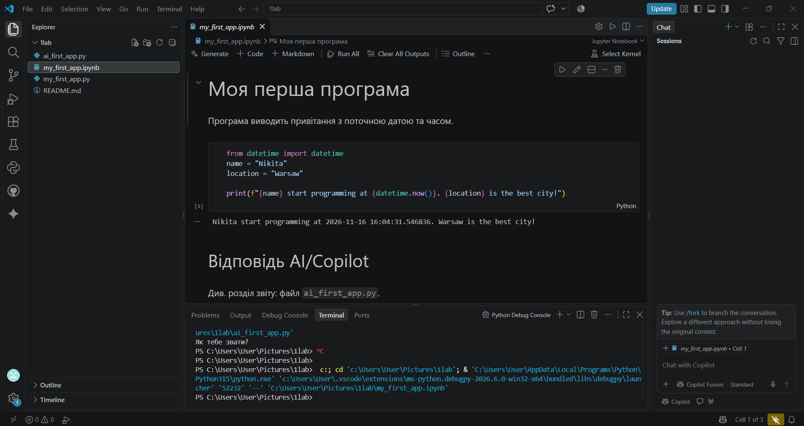

# Звіт до роботи

## Тема: *Перша програма на Python та оформлення звіту*

## Мета роботи: *написати першу програму на Python і створити звіт із використанням форматування Markdown*

---

## Виконання роботи

### Завдання 1. Встановлення плагінів VS Code

1. Розробили/Створили робоче середовище: у вкладці `Extensions` встановили розширення **Python**, **Jupyter** та **Copilot**.
2. Перезавантажили VS Code, підсвічування коду Python працює, Copilot дає підказки.


### Завдання 2. Перша програма на Python

1. Створили папку `1lab` та файл `my_first_app.py`.
2. Програма вивела значення:

```python
from datetime import datetime
name = "Nikita"
location = "Warsaw"

print(f"{name} start programming at {datetime.now()}. {location} is the best city!")
```

Результат виконання:

```text
Nikita start programming at 2026-11-16 16:03:34.359974. Warsaw is the best city!
```



### Завдання 3. Python Notebook

1. Створили файл [`my_first_app.ipynb`](my_first_app.ipynb), скопіювали код у першу комірку та виконали **Run All**.
2. Додали комірку типу `Markdown` з описом «Моя перша програма», оформили заголовком (`#`) — після `Run All` вигляд комірки змінився з простого тексту на заголовок.
3. Файл ноутбука з виконаними комірками додано до репозиторію та зафіксовано комітом.



### Завдання 4. Запитання до AI/Copilot

**Запитання:** яку першу програму ти б написав і чи зміг би її пояснити?

**Відповідь AI (файл [`ai_first_app.py`](ai_first_app.py)):**

```python
from datetime import datetime

name = input("Як тебе звати? ")
hour = datetime.now().hour

if hour < 12:
    greeting = "Доброго ранку"
elif hour < 18:
    greeting = "Доброго дня"
else:
    greeting = "Доброго вечора"

print(f"{greeting}, {name}! Ласкаво просимо у світ Python 🐍")
```

**Пояснення:**
- `from datetime import datetime` — підключаємо клас для роботи з датою й часом;
- `input(...)` — зчитує ім'я, яке вводить користувач;
- `datetime.now().hour` — поточна година (0–23);
- `if / elif / else` — вибирає привітання залежно від часу доби;
- `print(f"...")` — виводить рядок, підставляючи змінні у фігурні дужки (f-рядок).

Перевірка: програму запустили на комп'ютері, вона працює. Приклад виводу при введенні `Nikita`:

```text
Доброго дня, Nikita! Ласкаво просимо у світ Python 🐍
```

---

## Висновок

- ❓ **Що зроблено в роботі:** налаштували VS Code (Python, Jupyter, Copilot), написали першу програму `.py`, створили Notebook `.ipynb` з Markdown-коміркою, оформили звіт і завантажили роботу в репозиторій.
- ❓ **Чи досягнуто мети роботи:** так, середовище налаштоване, програма працює, звіт оформлено за шаблоном.
- ❓ **Які нові знання отримано:** запуск Python-файлів у VS Code, робота з f-рядками та модулем `datetime`, комірки Notebook (Code/Markdown), форматування Markdown, фіксація змін комітами.
- ❓ **Чи вдалось відповісти на всі питання, задані в ході роботи:** так.
- ❓ **Чи вдалося виконати всі завдання:** так.
- ❓ **Чи виникли складності у виконанні завдання:** ні, складнощів не виникло, усі завдання вдалося виконати без проблем.
- ❓ **Чи подобається такий формат здачі роботи (Feedback):** так, подобається: усе зберігається в репозиторії, а звіт у форматі Markdown зручно оформлювати та перевіряти.
- ❓ **Побажання для покращення (Suggestions):** було б добре надати більше часу на здачу робіт.
